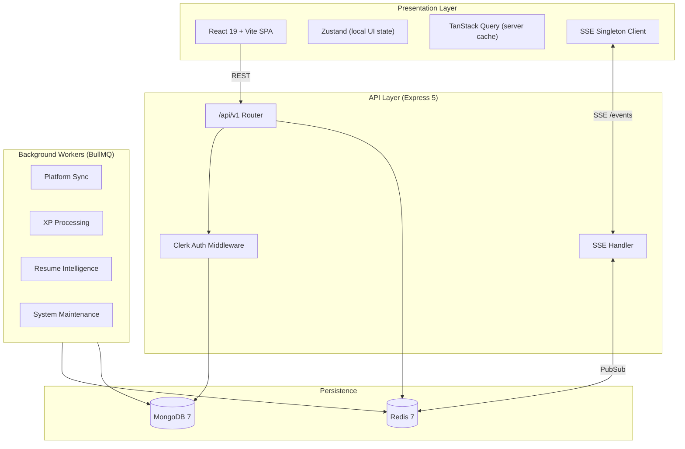

# System Architecture

DevTrack is a monorepo with a React SPA frontend, an Express API, and standalone BullMQ worker processes. Background work (platform sync, resume intelligence, XP) is isolated from the HTTP thread to keep API latency predictable.

---

## Topology



---

## Monorepo Layout

| Package | Entry | Role |
|---------|-------|------|
| `frontend/` | `src/main.tsx` | React SPA, Clerk auth, SSE client |
| `backend/` | `src/index.ts` | Express HTTP server |
| `backend/` | `src/worker-entrypoint.ts` | BullMQ worker dispatcher |
| `dev-orchestrator/` | `src/index.ts` | Local dev boot sequence |
| Root | `docker-compose.yml` | Container orchestration |

---

## API Versioning

- **Canonical path:** `/api/v1`
- **Legacy alias:** `/api` (returns deprecation header)
- **Infrastructure (unversioned):** `/health`, `/metrics`, `/api/system/*`

Defined in `backend/src/config/constants.ts`:

```ts
export const API_VERSION = 'v1';
export const API_BASE_PATH = '/api/v1';
```

---

## Authentication

DevTrack uses **Clerk** for authentication — not custom JWT.

| Layer | Mechanism |
|-------|-----------|
| Frontend | `@clerk/clerk-react` — sign-in/sign-up UI |
| Backend | `@clerk/express` middleware + `CLERK_SECRET_KEY` |
| User sync | `ClerkUserSyncService` creates/updates MongoDB user records on first request |
| SSE | `POST /api/v1/auth/sse-handshake` issues a short-lived token; `GET /api/v1/events?token=` |

Protected routes use `authMiddleware`. Admin and ops routes use `adminMiddleware` / `opsAuditorMiddleware`.

Resume limits run after authentication: writes and `GET /resume-intelligence/credibility`
(which reruns orchestration) share five processing requests per five minutes per user.
Saved-state reads have a separate 120-request/minute user budget. Session/status and
saved-report polling use a 600-request/minute IP ingress guard instead of the general
100-request/15-minute API guard, so ordinary 1.5-second polling can continue through
completion. The IP guard also covers rejected authentication attempts. Processing
abuse retains its ten-minute block; read floods receive a 30-second block.

The resume client honors `Retry-After` seconds or HTTP dates for status polling.
Missing or invalid retry guidance uses exponential backoff
from three seconds to one minute; a longer server delay takes precedence. A
successful status response restores the normal polling interval. The shared SSE
connection remains independent of these resume budgets.

Run the isolated production HTTP regression without database cleanup or live
credentials from `backend/` with
`node node_modules/vitest/vitest.mjs run -c vitest.rate-limit.config.ts`.

---

## Real-time: SSE Singleton Pattern

Browser tab limits make per-component SSE connections expensive. DevTrack uses a singleton coordinator:

1. **Client:** One shared connection managed via `useSyncExternalStore`; all tabs share the channel.
2. **Server:** Express registers keep-alive SSE clients in `sseHandler.ts`.
3. **PubSub:** Job completions broadcast through a Redis channel; the SSE handler pushes events to connected clients.

Event types include platform sync completion, XP updates, notification delivery, and runtime state changes.

---

## Background Job Queue

Powered by **BullMQ** on **Redis**. Workers run in separate processes (or containers in production).

### Queue names

| Queue | Purpose |
|-------|---------|
| `platform-sync` | LeetCode, Codeforces, CodeChef, GitHub crawlers |
| `xp-processing` | XP and level calculations |
| `streak-recalc` | Streak reconciliation |
| `notifications` | Notification dispatch |
| `profile-rebuild` | Profile stat reconstruction |
| `readiness-*` | Readiness snapshot and domain rebuilds |
| `resume-*` | Upload, ATS, semantic, embedding, credibility, variant, export |
| `system-maintenance` | Scheduled cleanup and reconciliation |
| `dataset-ingestion` | Dataset scan and ingest (ops) |

### Worker topology

**Development:** `npm run dev:workers` or `npm run dev:all`

**Production (`docker-compose.prod.yml`):**

| Container | `WORKER_TYPE` | Role |
|-----------|---------------|------|
| `api` | — (`ENABLE_WORKERS=false`) | HTTP + SSE only |
| `worker-sync` | `sync` | Platform crawlers |
| `worker-xp` | `xp` | XP, streaks and notifications |
| `worker-readiness` | `readiness` | Six Readiness intelligence consumers |
| `worker-resume` | `resume-intelligence` | Resume consumers and profile rebuild |
| `worker-dataset` | `dataset` | Dataset ingestion |
| `worker-maint` | `maintenance` | Maintenance |

The standalone dispatcher accepts exactly `sync`, `xp`, `readiness`, `maintenance`,
`resume-intelligence`, `dataset`, and `all`. An unset or empty selector defaults to
`all` for local development; production services must select an explicit role.
Unknown values fail before loading service modules or connecting to databases.
There is no standalone orchestration-compensation consumer: `orch` and
`orchestration` are invalid selectors. The resume role groups existing consumers;
it does not add a new orchestration engine. `all` is the union of the six roles.

Backend `worker:*` scripts use the same dispatcher with a positional selector.
An explicit positional selector takes precedence over `WORKER_TYPE`. Shutdown
waits for startup to settle, drains registered consumers concurrently,
then disconnects MongoDB and shared Redis. A nine-second deadline bounds pending
startup, drain and service cleanup; timeout exits nonzero and unfinished jobs rely
on BullMQ stalled-job recovery. The API retains its ten-second process exit cap. Partial startup failures also drain
registered consumers and exit nonzero; cleanup continues if one close fails.

API startup uses the same lazy registry as the standalone dispatcher when
`ENABLE_WORKERS` is unset or anything other than `false`. Set `ENABLE_WORKERS=false`
on API processes when using standalone workers, including local `dev:all` alongside
`dev:workers`, to choose one execution topology. The registry covers all existing
worker constructors: six Readiness consumers, the legacy Resume feature queues,
and session-based `resume-upload`, `resume-ats`, `resume-embedding`, `resume-semantic`
and `resume-recommendation` consumers. Queue constants without an existing consumer
(such as `resume-replay`) do not imply a registered worker.

The admin-only `/api/system/queue-status` endpoint includes every registered queue
and role, job counts and the number of Redis-observed consumers. This includes
standalone consumers in other processes. Missing consumers and unavailable Redis
are explicit statuses; failed queries return null counts rather than healthy zeros.
Health queries have a one-second deadline.

Run registry, startup, deadline and health tests from `backend/` with
`node node_modules/vitest/vitest.mjs run -c vitest.worker-lifecycle.config.ts`.
The live queue suite uses real BullMQ plus an owned MongoDB instance and a unique
Redis namespace: set `WORKER_TEST_REDIS_URL` to a disposable Redis URL and run
`node node_modules/vitest/vitest.mjs run -c vitest.worker-queues.config.ts` with
`MONGODB_URI` unset. CI runs this suite against its Redis service. It verifies saved
results from `readiness-dsa` and `resume-ats`; without the explicit URL it is skipped.

Platform sync is **idempotent**: each external submission maps to `platform + externalId` to prevent duplicates.

Terminal worker failures are captured by `attachWorkerDlq` in `shared/jobs/dlq.service.ts`.
Factory workers install it automatically; other workers use `createDlqWorker`, which
preserves their retry behavior and discards explicit `NonRetryableError` jobs.
The hook uses each job's configured attempts and captures early unrecoverable failures.
Dead letters wait in `<source-queue>-dlq` (BullMQ forbids colons in queue names),
including payload, processor name, retry settings, stack, attempt counts and category.
Capture IDs deduplicate repeated events; worker shutdown drains pending captures.
Factory workers also retain their existing MongoDB failure audit.

Admin-only recovery endpoints are `GET /api/system/dlq?queue=<source-queue>`
(with optional `offset` and `limit`, capped at 100),
`POST /api/system/dlq/:id/retry?queue=<source-queue>`, and
`DELETE /api/system/dlq/:id?queue=<source-queue>`. Queue names are allowlisted.
Replay preserves the original processor name and retry settings, coalesces concurrent
requests with a deterministic replay ID, and removes the dead letter only after enqueue.
The existing six-hour maintenance task removes entries older than seven days across
all known queues. DLQ storage depends on Redis persistence; a failed capture is logged
and the original source job remains subject to its configured failed-job retention.

Run isolated queue-boundary and HTTP recovery tests from `backend/` with
`node node_modules/vitest/vitest.mjs run -c vitest.dlq.config.ts`.
These mock Redis/BullMQ; live Redis capture and replay remain a separate validation.


---

## Backend Modules

23 route modules mounted in `backend/src/routes/index.ts`:

| Module | Mount | Description |
|--------|-------|-------------|
| `auth` | `/auth` | Clerk user sync, SSE handshake |
| `dashboard` | `/dashboard` | Stats, streaks, missions, GitHub, activity |
| `dsa` | `/dsa` | Problems, stats, heatmap, submissions, contests |
| `activity` | `/activity` | Feed, heatmap, focus sessions |
| `projects` | `/projects` | Projects, tasks, GitHub sync |
| `profile` | `/profile` | User profile, platforms, public profiles |
| `settings` | `/settings` | User preferences |
| `platform-sync` | `/platforms` | Manual and scheduled sync |
| `xp` | `/xp` | Experience points |
| `streak` | `/streak` | Streak tracking and freeze |
| `ops` | `/ops` | Admin console, queues, DLQ, trust scores |
| `runtime-state` | `/runtime-state` | Unified runtime state rebuild |
| `observation` | `/observation` | Session replay, momentum, retention |
| `missions` | `/missions` | Daily/weekly missions |
| `notifications` | `/notifications` | In-app notifications |
| `onboarding` | `/onboarding` | Onboarding step tracking |
| `daily-challenge` | `/daily-challenge` | Daily challenge generation |
| `coaching` | `/coaching` | AI coaching insights |
| `readiness` | `/readiness` | Snapshots, intent, skill progress, DSA sub-routes |
| `resume` (upload) | `/resume` | File upload and session status |
| `resume-intelligence` | `/resume-intelligence` | ATS, variants, credibility, export |
| `recommendations` | `/recommendations` | Intelligence reports |
| `analytics` | `/analytics` | Event tracking, feedback, beta dashboard |

### Intelligence subsystems

Beyond route modules, these internal engines power resume and readiness features:

- `intelligence-runtime/` — Parsing, retrieval, credibility, replay
- `modules/ai/` — Provider adapters (OpenAI/Gemini), embeddings, retrieval
- `modules/ml/` — Ranking, governance, training pipelines
- `modules/validation/` — Load testing, scenario replay, benchmarking

---

## Database

**60+ Mongoose models** in `backend/src/db/models/`, grouped by domain:

| Domain | Models (examples) |
|--------|-------------------|
| User & Auth | `user`, `userProfile`, `userSettings` |
| DSA | `dsaProblem`, `dsaSubmission`, `dsaProfile`, `dsaContest` |
| Resume | `resumeProfile`, `resumeSession`, `atsAnalysis`, `embedding` |
| Readiness | `readinessCore`, `readinessRoadmap`, `careerIntent` |
| Activity | `activityEvent`, `focusSession`, `dailyActivity` |
| Gamification | `userXp`, `userStreakLog`, `mission`, `dailyChallenge` |
| Platform | `connectedPlatform`, `platformStats`, `syncJob` |
| Ops | `deadLetterJob`, `aiResponseAuditLog`, `behavioralTelemetry` |

Indexes are set up via `backend/src/db/migrations/index-setup.ts`.

---

## Frontend Architecture

### Routing

React Router v7 with lazy-loaded pages and `ErrorBoundary` wrappers. Protected routes sit behind `ProtectedLayout` + `AuthSyncGate` (Clerk → `/auth/me` sync).

### State management

| Type | Tool | Examples |
|------|------|---------|
| Server state | TanStack Query | Dashboard, DSA, readiness data |
| Client state | Zustand | Missions, gamification, UI overlays |
| Real-time | SSE hook | `useSse`, `RealtimeLayer` |

### Feature modules (`frontend/src/features/`)

`admin`, `ai`, `coaching`, `dashboard`, `dsa`, `gamification`, `intelligence-experience`, `notifications`, `onboarding`, `projects`, `readiness`, `realtime`, `resume-tracker`, `settings`

### API clients (`frontend/src/services/`)

16 service modules using `axiosClient` with Clerk token injection. Base URL from `VITE_API_BASE_URL`.

---

### Settings write contract

The authenticated settings GET endpoint returns stored preferences, while PUT
currently accepts only `platforms` with `github`, `codeforces`, `leetcode` and
`codechef` objects. Each accepts optional string `username` and `handle` fields
limited to 100 characters; empty strings clear identifiers. The server rejects
unknown categories, invalid values, empty writes and client-supplied metadata
such as `lastSyncedAt`. Omitted fields remain unchanged.

The settings screen sends only changed supported platform fields. It keeps drafts
and saved values separately, uses per-field revisions to retain later edits during
a write, blocks competing writes, and ignores stale loads or responses after a
store reset. Failed saves preserve edits and stop automatic retries until a new
edit or explicit Save Now. Discard restores the saved platform values locally.

Theme uses the existing browser-local store independently of account saves.
Other rendered settings and destructive actions are disabled until implemented;
command-palette shortcuts cannot toggle unavailable settings. A stored preference
in a GET response does not imply the current API supports editing or applying it.

## Platform Integrations

| Platform | Method | Coverage |
|----------|--------|----------|
| Codeforces | REST API | Full submission history |
| GitHub | REST/GraphQL API | Repos, commits, stats |
| LeetCode | GraphQL (public) | Partial — API limitations |
| CodeChef | Web scraping | Stats only |

Optional `GITHUB_TOKEN` raises GitHub API rate limits.

Platform sync delegates provider requests to the registered adapters in
`backend/src/modules/platform-sync/adapters/`. Their common base applies circuit
breakers and consistent failure results; shared HTTP requests retain bounded
timeouts and exponential backoff for network failures, 429s and 5xx responses.
Provider-owned helpers preserve the existing dashboard stats and calendar fields.
The coordinator owns the distributed mutex, cooldown, sync job state, readiness
refresh and lifecycle notifications. The queue worker does not repeat the
coordinator's start/completion/failure notifications for returned sync results.

Adapters normalize submissions and contests before the shared persistence layer.
LeetCode keeps provider submission IDs, with a `slug:timestamp` fallback when an
ID is absent; the problem slug remains a separate problem identifier. Imports
increment problem counts and daily activity only after admitting a new submission
ID. Codeforces retains its rolling 365-day attempt history and all verdicts;
LeetCode retains the public recent-accepted limit of 500. CodeChef remains
stats-only through profile scraping and produces no fabricated submissions or
fallback statistics. No existing submission IDs are rewritten.

Run mocked-provider tests and adapter coverage from `backend/` with
`node node_modules/vitest/vitest.mjs run -c vitest.adapters.config.ts --coverage`.
The sync integration regressions use the disposable MongoDB test setup and mocked
provider responses; they do not require live platform credentials.

---

## Observability

| Endpoint | Auth | Purpose |
|----------|------|---------|
| `GET /health` | Public | Liveness |
| `GET /health/detailed` | Admin | Deep health |
| `GET /metrics` | Admin | Prometheus text |
| `GET /api/v1/ops/*` | Admin/ops | Queues, DLQ, cache, trust, AI audits |

Structured logging via Winston (`backend/src/shared/logger.ts`). Failed jobs route to the dead-letter queue (`dlq.service.ts`).

The full `GET /api/v1/dashboard` response uses a user-scoped Redis key with a
five-minute TTL. Concurrent misses share one dashboard load per API process;
individual dashboard subresource endpoints retain their existing read behavior.
Activity, problem, project, platform connection/sync and mission writes invalidate
the dashboard after persistence, alongside the existing XP and streak hooks.
Redis invalidation advances a generation atomically with deletion; conditional
fills prevent an API load from caching stale data after a worker invalidates it.
Generation keys are retained so an older in-flight load cannot reuse an expired
generation. Coalescing is local to a process, rather than a distributed lock.

Cache errors fall back to database reads, and cache commands have a 500ms wait
limit so connection retries cannot indefinitely block dashboard reads or committed
writes. During a Redis outage, invalidation is best effort and existing entries
can remain stale until their five-minute TTL expires. The protected
`/api/system/request-metrics` response includes process-local `cache` counters:
`hits`, `misses`, `coalesced`, `loads`, `bypasses`, `errors`, and `inFlight`.
Misses count requests without a cached value; loads count actual database loads.

---

## CI/CD

`.github/workflows/pr-checks.yml` on PRs to `main`/`develop`:

1. TypeScript compile + ESLint
2. Backend + frontend unit tests
3. Integration tests (Mongo 6 + Redis 7 service containers)
4. Docker image build verification

Production deploy workflows target **Railway** (backend) and **Vercel** (frontend).

---

## Related Docs

- [DEPLOYMENT.md](./DEPLOYMENT.md) — Production env vars and scaling
- [CONTRIBUTING.md](./CONTRIBUTING.md) — Module conventions
- [PROJECT_STATUS.md](./PROJECT_STATUS.md) — Current gaps and health
