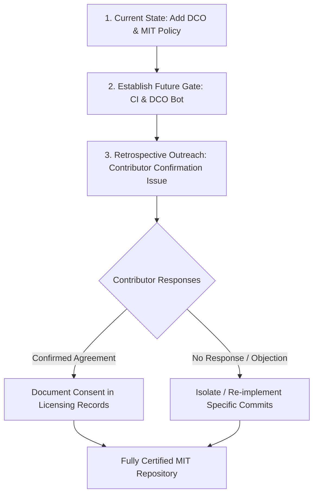

# Historical Contributor Licensing Audit

**Project:** DevTrack (`https://github.com/VarshithReddy2006/DevTrack`)  
**Audit Date:** November 13, 2026  
**Auditor:** Automated Repository Governance & Licensing Inspection  
**Audit Scope:** Git history from initial commit (`1cb61d3`) to `chore/add-dco-policy`  

---

## 1. Executive Summary

DevTrack is transitioning to formal open-source distribution under the **MIT Licence**. As part of this transition, a Developer Certificate of Origin (DCO 1.1) sign-off policy has been established for all future contributions.

This document records an objective, factual audit of historical commits merged prior to the enactment of the mandatory DCO policy. 

### Key Findings

- **Total Historical Commits Audited:** 283
- **Total Historical Pull Requests Merged:** ~125
- **Commits Carrying DCO Sign-offs:** 12 (4.2%)
- **Unsigned Commits:** 271 (95.8%)
- **Contributors Who Signed Off At Least One Commit:** 3 (Sarbajit Sengupta, anubaghel, Abhishek Choudhary)
- **Contributors Whose Entire Contribution History Is Signed Off:** 1 (Sarbajit Sengupta — 6 of 6 commits)
- **Historical Contributions with No Verified Licence Grant:** 271 commits
- **Contributions with Undetermined / Unverified Legal Status:** All external contributions where no express CLA or DCO was recorded
- **Formal Contributor Licence Agreement (CLA) on File:** **None**
- **Developer Certificate of Origin (DCO) Enforced Historically:** **No**
- **Program-Specific Copyright Assignment:** **None documented**

> [!IMPORTANT]
> **Legal Posture Regarding Retroactivity:**  
> Neither adding a root `LICENSE` file nor implementing a future-facing DCO sign-off policy retroactively alters the copyright ownership or licensing terms of code submitted and merged prior to this policy. Under copyright law, authors retain copyright in their original creative contributions unless explicitly assigned or licensed. Contributor consent cannot be assumed or fabricated.

---

## 2. Contributor Roster and Evidence Audit

Below is the complete roster of contributors identified across the repository's Git commit history, categorized by their documented sign-off status.

### 2.1 Project Maintainers & Core Authors

| Author Identity | Commits | DCO Trailers | Notes / Scope |
|---|---|---|---|
| **SHAVVA VARSHITH REDDY** / `VarshithReddy2006`   `<varshithreddy6147@gmail.com>` | 119 | 0 | **Repository Owner & Primary Maintainer.** Architecture, core monorepo setup, full-stack modules, CI/CD, and release management. |
| **BHANU TEJA GUPTA VUPPU** / `VBTG` / `VUPPU BHANU TEJA GUPTA`   `<vuppubhanu18@gmail.com>` | 109 | 0 | **Core Collaborator.** Data models, platform sync, analytics engines, background workers, and deployment configuration. |

*Maintainer Assessment:* As project founder and core author, Varshith Reddy holds copyright in his original contributions and has licensed them under the root MIT Licence. Core collaborator Bhanu Teja Gupta Vuppu has worked as an integral co-author across early development. Formal written affirmation from Bhanu Teja Gupta Vuppu to license all past contributions under the MIT Licence is recommended for clean legal chain of custody.

---

### 2.2 External Contributors with Explicit Sign-off Evidence

| Contributor | Commits | Signed | Unsigned | Primary Scope | Evidence / Notes |
|---|---|---|---|---|---|
| **Sarbajit Sengupta**   `<sarbajitsengupta1712@gmail.com>` | 6 | 6 | 0 | Event write coalescing (`b12005d`), test fixture isolation, Vitest integration (`176a5e5`, `5c98e12`). | **100% Signed Off.** All 6 commits include explicit `Signed-off-by: Sarbajit Sengupta <sarbajitsengupta1712@gmail.com>` trailers. |

---

### 2.3 External Contributors with Partial or Incomplete Sign-off Evidence

| Contributor | Commits | Signed | Unsigned | Primary Scope | Evidence / Notes |
|---|---|---|---|---|---|
| **anubaghel** / **Harshit baghel**   `<anubaghel470@gmail.com>` | 14 | 3 | 11 | Ops queue inspection (`ed80579`), BullMQ resume stage worker refactoring (`9775edd`), session security (`e8dfa2f`), scheduled platform sync (`85ae68a`). | **Partial Sign-off.** Commits `ed80579`, `9775edd`, and `758655f` contain valid DCO trailers. 11 earlier commits lack trailers. |
| **Abhishek Choudhary**   `<Abhishekcse2004@gmail.com>` | 6 | 3 | 3 | Navigation routing, UI polish, component fixes. | **Partial Sign-off.** 3 commits carry DCO trailers; 3 commits lack trailers. |

---

### 2.4 External Contributors without Documented Sign-off

The following individuals contributed code merged through pull requests without a recorded `Signed-off-by` trailer or repository-visible CLA:

| Contributor | Git Commits | Scope / Impact Area | Status |
|---|---|---|---|
| **Trunal Patil**   `<patiltrunal06@gmail.com>` | 15 | UI redesigns, styling refinements, dashboard views. | *Unverified* |
| **Harshvardhan Agrawal** / `Harshvardhan`   `<harsh60792@gmail.com>` | 7 | SSE cross-instance Redis delivery (`6cd0f0b`), Docker deployment configuration (`51d5f96`), readiness filter fixes (`310df1f`). | *Unverified* |
| **ankitkr104**   `<itx.ankit.kr@gmail.com>` | 2 | Bug fixes and minor adjustments. | *Unverified* |
| **Aaqibhafeez Khan**   `<githubaaqibhafeezkhan@gmail.com>` | 1 | Documentation and minor configuration. | *Unverified* |
| **Mohammad Garmabi**   `<49670466+mohamadgarmabi@users.noreply.github.com>` | 1 | Minor frontend enhancement. | *Unverified* |
| **zgy**   `<101915083+bfs2021@users.noreply.github.com>` | 1 | Minor bug fix. | *Unverified* |
| **Chanchal Gupta**   `<190047591+chanchall26@users.noreply.github.com>` | 1 | Minor bug fix. | *Unverified* |
| **Subodh**   `<subodh171011@gmail.com>` | 1 | Minor enhancement. | *Unverified* |

---

## 3. Analysis of Open-Source Programmes (NWoC / NSoC 2026)

Multiple commit subjects and PR titles reference `[Nsoc 2026]` or `NWoC 2026` (Nexus Winter of Code 2026).

### Legal Significance

- Mentorship programs and student hackathons frequently facilitate open-source contributions to participating repositories.
- However, **programme participation does not inherently convey intellectual property ownership or an implied open-source licence grant** to the repository maintainer unless:
  1. The programme terms required participants to sign an explicit Contributor Licence Agreement (CLA) or assign rights; and
  2. The repository was formally designated under those terms with participant agreements verified.
- As explicitly documented in DevTrack's maintainer guidance (`CONTRIBUTING.md`):
  > *"Programme participation and the availability of a public repository do not, by themselves, establish an open-source licence."*
- **Status:** **UNVERIFIED.** No repository-visible documentation proves that NWoC 2026 participants executed an agreement transferring copyright or explicitly granting MIT licensing terms for historical contributions.

---

## 4. Third-Party Code, Datasets, and Trademarks

Beyond contributor-authored code, the repository contains assets that require separate licensing treatment:

### 4.1 Third-Party Trademarks and Logos
- **Files:**
  - `frontend/src/assets/logos/CodeChef.png`
  - `frontend/src/assets/logos/Codeforces.png`
  - `frontend/src/assets/logos/github.png`
  - `frontend/src/assets/logos/LeetCode.png`
  - `frontend/public/logos/leetcode.svg`, `codeforces.svg`, `codechef.svg`, `github.svg`
- **Licensing Analysis:** These logos are registered or common-law trademarks belonging to their respective platform operators (LeetCode LLC, Codeforces, CodeChef / Unacademy, GitHub Inc. / Microsoft). They are not covered by the MIT Licence and remain the property of their respective trademark holders. Fair use for referential linking does not grant proprietary rights.

### 4.2 Raw Datasets
- **Files:**
  - `backend/src/datasets/raw/Resume.csv` (56 MB)
  - `backend/src/datasets/raw/resume_dataset_1200.csv` (508 KB)
  - `backend/src/datasets/raw/resume_dataset_200k_enhanced.csv` (14 MB)
- **Licensing Analysis:** These datasets contain personal and resume metadata likely sourced from public machine-learning corpora (e.g., Kaggle or Hugging Face). They may carry third-party data licenses (e.g., CC-BY, CC0, or proprietary terms of use) and potential privacy restrictions. They must be evaluated independently of the core application code.

### 4.3 Open-Source Dependencies
- **Stack:** Node.js monorepo with Express, React, TypeScript, Vitest, Mongoose, Redis, and Tailwind CSS.
- **Licenses:** Audited dependencies use standard permissive licenses (MIT, Apache-2.0, BSD-2-Clause, BSD-3-Clause, ISC, 0BSD).
- **Compliance:** Permissible dependencies do not conflict with the MIT Licence, provided standard attribution notices are maintained when redistributing bundled artifacts.

---

## 5. Recommended Remediation & Action Plan

To establish clear, legally robust licensing without disrupting ongoing development:

### Action Items for Repository Maintainer

1. **Do Not Rewrite History or Fabricate Sign-Offs:**
   Under no circumstances should Git history be rewritten (`git filter-repo` or rebase) to retroactively append `Signed-off-by` trailers to historical commits. That would falsify certification records.
2. **Issue a Contributor Affirmation Notice:**
   Open a dedicated GitHub issue or discussion titled:
   `"Licensing Clarification: Affirmation of MIT Licence Grant for Historical Contributions"`
   Provide a standard affirmation form allowing past contributors to comment and explicitly confirm that their historical PRs are licensed under the MIT Licence.
3. **Formalize Co-Maintainer Agreement:**
   Obtain written confirmation from core collaborator Bhanu Teja Gupta Vuppu confirming that all past contributions are released under the MIT Licence.
4. **Deploy Automated Enforcement for All Future Pull Requests:**
   Merge and activate the DCO validation CI workflow (`.github/workflows/dco.yml`) and optionally enable the Probot DCO GitHub App (`https://github.com/apps/dco`) to prevent any future unsigned PRs from merging.
5. **Add Trademark & Dataset Disclaimers:**
   Include clear disclaimer notes in `README.md` and dataset documentation clarifying that platform logos remain the property of their trademark owners and that datasets are governed by their respective source terms.

